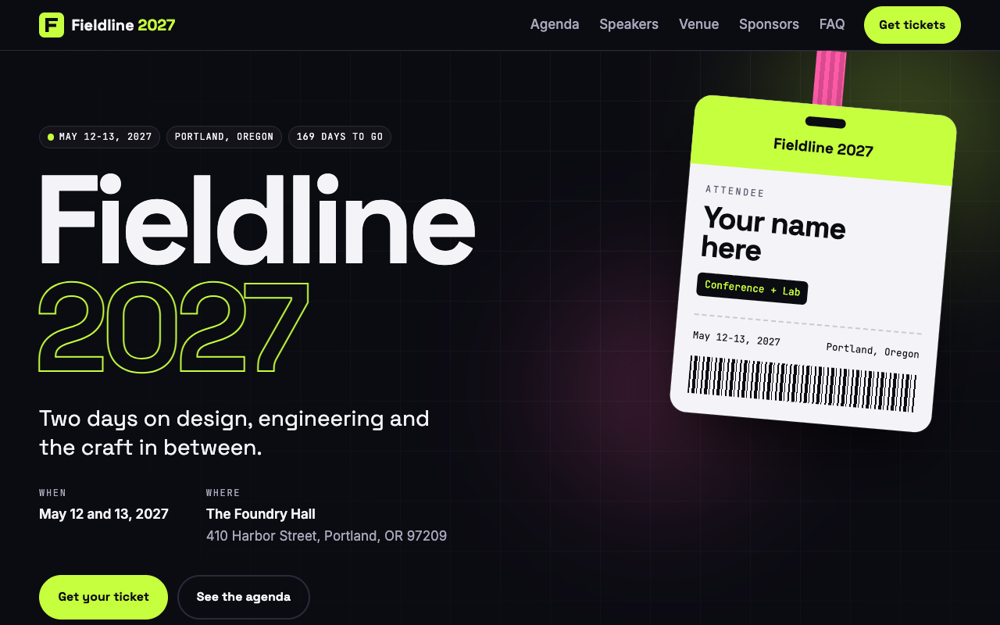

# Event and conference website template

A bold, fast conference website with an agenda, speaker pages, venue and travel, sponsors, tickets and FAQ. Built with Astro as a fully static site.



[](https://console.cloudzyro.com/new?repo=https://github.com/Cloudzyro/template-event)

## What's included

- Hero with the event name, dates, venue, a "days to go" counter and a scrolling topics strip
- Agenda grouped by day, with Build, Design and Lab tracks, times, rooms and speakers, plus a track filter (without JavaScript every session is shown)
- Speakers grid and a page for every speaker (`/speakers/<name>/`) with bio and their sessions
- Generated abstract speaker portraits and sponsor wordmarks as inline SVG, so there are no photos to license
- Venue and travel: map placeholder that opens a map search, getting there by air, transit, bike and car, and hotels with booking codes
- Sponsors in three tiers, plus a "Become a sponsor" call to action
- Ticket tiers with prices, features, sold-out state and links to your ticketing page
- FAQ with accessible expand and collapse
- Contact form that posts to any form service, with an email fallback
- SEO: page titles and descriptions, Open Graph and Twitter cards, `sitemap-index.xml`, `robots.txt`, favicon
- Responsive down to 360px, keyboard friendly, visible focus styles, respects reduced motion
- No tracking and no third-party scripts; fonts are self-hosted

## Run it locally

```bash
pnpm install
pnpm dev       # http://localhost:4321
pnpm build     # static site in dist/
pnpm preview   # serve the build
```

Requires Node 20 or newer.

## Make it yours

**Content.** Everything lives in [`src/data/event.ts`](./src/data/event.ts): event name, dates, city, ticket link, navigation, stats, tracks, sessions, speakers, venue, hotels, sponsors, ticket tiers, FAQ and contact text. Sessions refer to speakers by their `slug`, and a page is created for every speaker automatically.

**Tickets.** Set `ticketUrl` in `src/data/event.ts` to your ticketing page (Tito, Eventbrite, Luma, a Stripe or Paddle payment link, anything with a URL). A tier can override it with its own `url`, and `soldOut: true` disables its button.

**Contact form.** Set a public environment variable to the address your form service gives you:

```bash
PUBLIC_FORM_ENDPOINT=https://formspree.io/f/your-form-id
```

It works with Formspree, Basin, a Supabase function or anything that accepts a form POST. Without it, the form says it isn't connected yet and opens the visitor's email app addressed to `contactEmail`. Copy `.env.example` to `.env` for local development; on Cloudzyro, add the variable in your site's settings and redeploy.

**Site address.** Set `SITE_URL` (or edit the fallback in `astro.config.mjs`) to your real domain so the sitemap, `robots.txt` and social previews use the right links.

**Colors and fonts.** The color tokens (`--accent`, `--pink`, `--blue`, backgrounds) are at the top of [`src/styles/global.css`](./src/styles/global.css). Track colors are set per track in `event.ts`. Fonts are Space Grotesk, Inter and JetBrains Mono from Fontsource; swap the imports in `src/layouts/Base.astro` and the `--font-*` tokens to change them.

**Images.** Speaker portraits and sponsor logos are generated in `src/lib/art.ts`. To use real sponsor logos, put files in `public/` and set `logo: "/your-logo.svg"` on the sponsor. Replace `public/og.png` (1200x630) with your own social preview image.

## Deploy

Click **Deploy to Cloudzyro** above, or push your own copy to GitHub and connect the repository in the Cloudzyro console. The build command is `pnpm build` and the output is the static `dist/` folder, so no server is needed.

## Stack

- [Astro](https://astro.build) 7, static output
- Hand-written CSS with custom properties
- [Fontsource](https://fontsource.org) self-hosted fonts
- `@astrojs/sitemap`

## License

MIT, see [LICENSE](./LICENSE).
